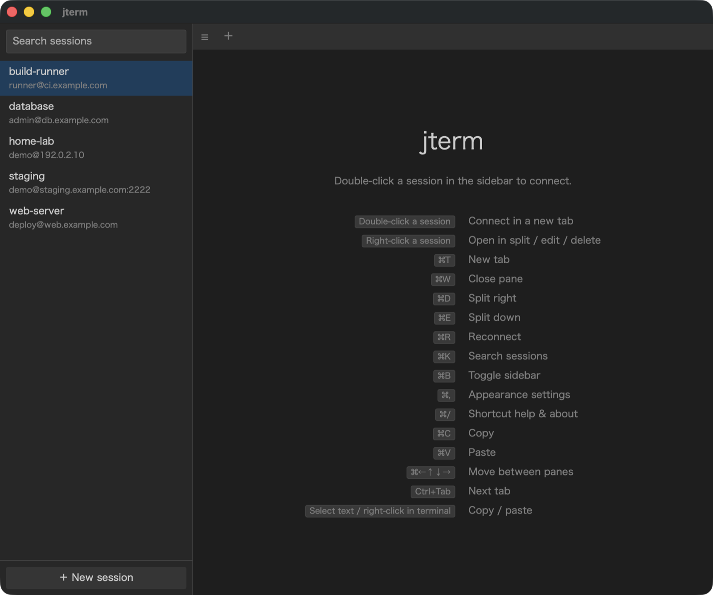

# jterm

A simple, focused SSH client for Windows and macOS.



- Saved sessions are listed in a sidebar; filter with search and connect
- One tab per connection, freely split left/right or top/bottom inside a tab
- Reconnect a disconnected pane with the R key (or the "Reconnect" button)
- Copy on select, paste on right click
- Per-session look: color theme, accent/background color and a background image (session editor → "Appearance for this session")

## Shortcuts

| Action | Windows | macOS |
|---|---|---|
| New tab | Ctrl+Shift+T | ⌘T |
| Close pane | Ctrl+Shift+W | ⌘W |
| Split left/right | Ctrl+Shift+D | ⌘D |
| Split top/bottom | Ctrl+Shift+E | ⌘E |
| Search sessions | Ctrl+Shift+K | ⌘K |
| Toggle sidebar | Ctrl+Shift+B | ⌘B |
| Appearance settings | Ctrl+Shift+, | ⌘, |
| Shortcut help & about | Ctrl+Shift+/ | ⌘/ |
| Move between panes | Ctrl+Shift+Arrow | ⌘+Arrow |
| Switch tab | Ctrl+Tab / Ctrl+Shift+1–9 | Ctrl+Tab / ⌘1–9 |
| Copy / Paste | Ctrl+Shift+C / V | ⌘C / ⌘V |

- Sidebar: double-click to connect in a new tab. Right-click for "Open in split", "Edit", "Duplicate", "Delete".
- Search box: ↑↓ to select, Enter to open in a new tab, Shift+Enter to open in a split to the right.
- A newly split pane shows a session picker, with the original pane's session preselected.
- Drag a divider to resize, drag a tab to reorder, middle-click a tab to close it.

## Authentication

1. Public key: the private key specified in the session. If none is specified, `~/.ssh/id_ed25519`, `id_ecdsa` and `id_rsa` are tried in that order. Passphrase-protected keys are supported.
2. Password / keyboard-interactive

A password can be entered in the session editor, or saved by checking "Remember password" in the connection dialog. It is stored in the OS credential store (Windows: Credential Manager, macOS: Keychain) and is never written to `sessions.json`.

Keys in `~/.ssh` appear in the dropdown; use "Browse…" for any other key. PuTTY-format keys (.ppk) are not supported; convert them to OpenSSH format with PuTTYgen.

For automated tests, set the environment variable `JTERM_TEST_MOCK_KEYRING=1` to use an in-memory fake instead of the OS credential store.

## Data location

- Windows: `%APPDATA%\jterm\`
- macOS: `~/Library/Application Support/jterm/`

`sessions.json` holds the session list, and `known_hosts` holds the host keys you have accepted.

## Architecture

- Backend: Go + [Wails v2](https://wails.io/). SSH connections use `golang.org/x/crypto/ssh`.
- Frontend: Vanilla JS + [xterm.js](https://xtermjs.org/) (`frontend/`)

## Build

Requires Go, Node.js and the Wails CLI (`go install github.com/wailsapp/wails/v2/cmd/wails@latest`).

```sh
# Windows (cross-building from macOS also works)
wails build -platform windows/amd64,windows/arm64
# macOS
wails build -platform darwin/universal
```

Artifacts are written to `build/bin/`. During development, `wails dev` hot-reloads your changes.

The Windows build needs the WebView2 runtime, which is preinstalled on Windows 10/11.

## Appearance

The ⚙ button (or ⌘,) opens the appearance settings: color theme, accent color, background color and background opacity. The ? button (or ⌘/) shows the shortcut list and links to the project and to [sponsor jojonki](https://github.com/sponsors/jojonki). Settings are stored locally.

## License

[MIT](LICENSE)
